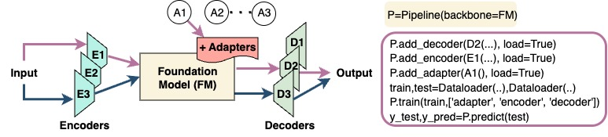

# FMTK: A Modular Toolkit for Composable Time Series Foundation Model Pipelines

## Overview
Foundation models (FMs) have opened new avenues for machine learning applications due to their ability to adapt to new and unseen tasks with minimal or no further training. Time-series foundation models (TSFMs)---FMs trained on time-series data---have shown strong performance on classification, regression, and imputation tasks. Recent pipelines combine TSFMs with task-specific encoders, decoders, and adapters to improve performance; however, assembling such pipelines typically requires ad hoc, model-specific implementations that hinder modularity and reproducibility. We introduce FMTK, an open-source, lightweight and extensible toolkit for constructing and fine-tuning TSFM pipelines via standardized backbone and component abstractions. FMTK enables flexible composition across models and tasks, achieving correctness and performance with an average of seven lines of code.



### Code Map
```
fmtk/
├── pipeline.py             # Main pipeline implementation
├── metrics.py              # Evaluation metrics
├── utils.py                # Evaluation metrics
├── logger.py               # Memory, Energy logger
├── datasets/
│   └── ecg5000.py          # ECG5000 dataset implementation
│   └── ... 
├── components/
│   ├── backbones/
│   │   └── chronos.py      # Chronos foundation model
│   │   └── ...            
│   ├── encoders/
│   │   └── ...             # Encoders
│   └── decoders/
│       ├── classification/  
│       │   └── ...         # Classification decoders
│       ├── regression/
│       │   └── ...         # Regression decoders
│       └── forecasting/
│           └── ...         # Forecasting decoders
```

## Installation

Clone the repo and run the install script:
```bash
git clone <repo-url>
cd FMTK
bash install.sh           # creates env named 'fmtk'
conda activate fmtk
```
To use a custom environment name:
```bash
bash install.sh my_env_name
conda activate my_env_name
```
The script creates a conda environment with all dependencies (including torch+CUDA, flash-attn, momentfm, and pyPPG) and installs FMTK in editable mode.

### Deprecated installation (manual)
> **Note:** This method is deprecated and will not install all required dependencies.
```bash
cd FMTK
conda create -n fmtk python=3.10
conda activate fmtk
pip install -e .
pip install pyPPG==1.0.41  # may conflict with other packages
```

For quick start please check out [examples](./examples).

## Experiment tracking

`Pipeline.train` takes an optional `ml_logger`. The caller opens the run, so anything logged after training lands in the same run. Use one run per `train` call.
```python
from fmtk.logger import MLFLOWLogger

with MLFLOWLogger("dino-voc", run_name="base") as ml:
    ml.log_params({"model_id": model_id})
    P.train(train_dl, val_dl, cfg=cfg, path=path, metric_fn=metric_fn, ml_logger=ml)
    P.load_best_checkpoint(path)
    y, p = P.predict(test_dl, cfg)
    ml.log_metrics({"test_metric": metric_fn(y, p)})
```
To resume, read the run id from the checkpoint so training continues in the same run:
```python
run_id = P.checkpoint_run_id(path, "last")
with MLFLOWLogger("dino-voc", run_id=run_id) as ml:
    P.train(train_dl, val_dl, cfg=cfg, path=path, metric_fn=metric_fn, ml_logger=ml, resume_from="last")
```
Decoders with their own `fit` (e.g. SVM, KNN) log no training metrics. To add another tracker, subclass `MLLogger` in [logger.py](./src/fmtk/logger.py).
