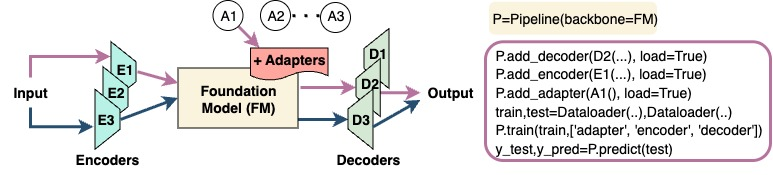

# FMTK: A Modular Toolkit for Composable Time Series Foundation Model Pipelines

## Overview
Foundation models (FMs) have opened new avenues for machine learning applications due to their ability to adapt to new and unseen tasks with minimal or no further training. Time-series foundation models (TSFMs)---FMs trained on time-series data---have shown strong performance on classification, regression, and imputation tasks. Recent pipelines combine TSFMs with task-specific encoders, decoders, and adapters to improve performance; however, assembling such pipelines typically requires ad hoc, model-specific implementations that hinder modularity and reproducibility. We introduce FMTK, an open-source, lightweight and extensible toolkit for constructing and fine-tuning TSFM pipelines via standardized backbone and component abstractions. FMTK enables flexible composition across models and tasks, achieving correctness and performance with an average of seven lines of code.



### Code Map
```
fmtk/
├── pipeline.py             # Main pipeline implementation
├── task_graph.py           # Named components and task paths (used by Pipeline)
├── metrics.py              # Evaluation metrics
├── utils.py                # Evaluation metrics
├── logger.py               # Memory, Energy logger
├── datasets/
│   └── ecg5000.py          # ECG5000 dataset implementation
│   └── ... 
├── components/
│   ├── backbones/
│   │   └── chronos.py      # Chronos foundation model
│   │   └── ...            
│   ├── encoders/
│   │   └── ...             # Encoders
│   └── decoders/
│       ├── classification/  
│       │   └── ...         # Classification decoders
│       ├── regression/
│       │   └── ...         # Regression decoders
│       └── forecasting/
│           └── ...         # Forecasting decoders
```

### Tasks and components
A pipeline can hold several named components and serve several tasks. Each task is a path through those components, starting from the backbone:
```python
p = Pipeline(backbone)                      # the backbone is registered as "backbone"
p.add_component("head_a", decoder_a)        # any object with forward(x), or a callable
p.add_component("adapter_x", my_component)
p.add_component("head_b", decoder_b)
p.register_task("task_a", ["backbone", "head_a"])
p.register_task("task_b", ["backbone", "adapter_x", "head_b"])

y = p.forward(x, task="task_b")                              # one task per call
ys = p.forward_tasks(x, ["task_a", "task_b", "task_a"])      # one task per sample
```
- Paths are checked, and added to the task DAG, when you call `register_task`, so `forward(x, task=...)` only runs the components in order, under `torch.inference_mode()`.
- `forward_tasks` runs each component once per wave on every sample whose path reaches it, including components shared after different backbones. It returns the per-sample outputs in input order.
- `remove_task(task_id)` also removes components that no other task uses.
- `forward(x)` without `task` keeps the original single-decoder behaviour.
- Tests and the overhead benchmark: `mkdir -p logs && sbatch tests/run_tests.sbatch`.

## Installation

Clone the repo and run the install script:
```bash
git clone <repo-url>
cd FMTK
bash install.sh           # creates env named 'fmtk'
conda activate fmtk
```
To use a custom environment name:
```bash
bash install.sh my_env_name
conda activate my_env_name
```
The script creates a conda environment with all dependencies (including torch+CUDA, flash-attn, momentfm, and pyPPG) and installs FMTK in editable mode.

### Deprecated installation (manual)
> **Note:** This method is deprecated and will not install all required dependencies.
```bash
cd FMTK
conda create -n fmtk python=3.10
conda activate fmtk
pip install -e .
pip install pyPPG==1.0.41  # may conflict with other packages
```

For quick start please check out [examples](./examples).
